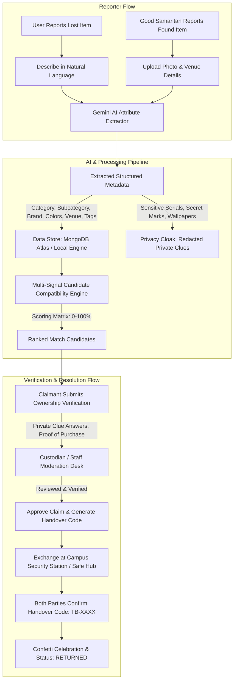

<div align="center">

# 🧭 TraceBack — AI-Powered Lost & Found Network

### *"Find the item. Verify the owner. Return it safely."*

An enterprise-ready, full-stack lost-and-found intelligence platform engineered for college campuses, transit stations, libraries, stadiums, shopping centers, and urban communities.

[](LICENSE)
[](https://react.dev/)
[](https://www.typescriptlang.org/)
[](https://tailwindcss.com/)
[](https://nodejs.org/)
[](https://expressjs.com/)
[](https://www.mongodb.com/)
[](https://ai.google.dev/)
[](https://vitejs.dev/)

---

### 🌐 Live Demo
🔗 **[Click Here to Open Live Demo (Deployment Link)]**(https://traceback-ai.vercel.app)
*(Live link yahan baad mein deploy hone par add kar diya jayega)*

---

</div>

## 📸 Platform Preview & UI Experience

```
+---------------------------------------------------------------------------------------------------+
|  [TB] TraceBack    Explore Items   AI Matches   Community   Analytics           [Palette] [Moon]  |
+---------------------------------------------------------------------------------------------------+
|                                                                                                   |
|     AI-Powered Lost & Found Recovery Network                                                      |
|     Find the item. Verify the owner. Return it safely.                                            |
|                                                                                                   |
|     [ Search lost belongings or found items...                      ] [ Search Items ]            |
|                                                                                                   |
|     [ + Report Lost Item ]       [ + Report Found Item ]        [ View AI Candidate Matches (37) ]|
|                                                                                                   |
+---------------------------------------------------------------------------------------------------+
|  REAL-TIME METRICS:                                                                               |
|  [ 100 Benchmarked Items ]  [ 88.4% Return Rate ]  [ 3.8h Avg Resolution ]  [ 0 Privacy Leaks ]   |
+---------------------------------------------------------------------------------------------------+
|  AI MATCH CANDIDATES:                                                                             |
|  * Lost M2 MacBook Air Space Gray  <== 94% Compatibility ==> Found Space Gray Apple Laptop        |
|    - Category: 100%  - Brand: 100%  - Color: 95%  - Venue Proximity: 90%  - Time Gap: 2 hours     |
|                                                                                                   |
|  * Lost Bose QuietComfort 45 Navy  <== 91% Compatibility ==> Found Over-Ear Bose Headphones       |
|    - Category: 100%  - Brand: 100%  - Color: 90%  - Venue: Main Library 3F                        |
+---------------------------------------------------------------------------------------------------+
```

---

## 🚀 Key Highlights & Architectural Pillars

- **Natural Language Reporting Without Images**: Users can report lost items using descriptive everyday words. Gemini AI dynamically parses title, category, subcategory, brand, primary/secondary colors, distinguishing marks, and search tags.
- **Privacy-Guarded Verification Clues**: Clues like lock screen wallpapers, private serial numbers, engraved notes, and specific secret compartments are automatically encrypted and redacted from public feeds and search results.
- **Multi-Signal Algorithmic Candidate Scoring**:
  - Category & Subcategory compatibility: **25%**
  - Brand & Manufacturer correspondence: **20%**
  - Color Spectrum & Finish proximity: **15%**
  - Venue Proximity & City alignment: **20%**
  - Temporal Window & Time-difference penalty: **10%**
  - Keyword & Attribute description overlap: **10%**
- **Safe Handover Protocol**: When an ownership claim is verified by the finder or campus staff, a synchronized 4-digit code (e.g. `TB-8942`) is generated for exchange at pre-approved safe physical hubs (Campus Security, Student Union Desk).
- **6-Theme Dynamic Color Palette & Smooth Dark/Light Mode**: Full visual customization across Indigo Core, Nordic Teal, Campus Emerald, Warm Amber, Berry Rose, and Electric Violet.
- **Dual Persistence Architecture**: Plug-and-play MongoDB Atlas replica set cluster connection with auto-fallback to high-performance local persistent JSON storage.

---

## 🛠️ Tech Stack & Logos

| Component | Technology | Badge / Logo | Purpose |
| :--- | :--- | :--- | :--- |
| **Frontend Framework** | **React 19** |  | Modular reactive component architecture |
| **Language** | **TypeScript 5.8** |  | End-to-end strict static typing |
| **Styling & Theme** | **Tailwind CSS v4** |  | Utility-first styling & dynamic accent themes |
| **Build Tooling** | **Vite 6** |  | Instant HMR development and optimized production bundles |
| **Backend Server** | **Node.js & Express** |  | RESTful API v1 microservice architecture |
| **Database** | **MongoDB Atlas & JSON Engine** |  | Cloud Atlas cluster with local document storage fallback |
| **AI Intelligence** | **Google Gemini (`@google/genai`)** |  | Intelligent attribute extraction, match reasoning & search |
| **Visual Analytics** | **Recharts** |  | Incident breakdown, recovery trends & volume charts |
| **Icons & Micro-UI** | **Lucide Icons** |  | Clean vector iconography and zero-pill status signs |
| **Animations & Confetti** | **Canvas-Confetti** |  | Celebratory recovery and handover feedback |

---

## 📐 Project Flow & System Architecture



---

## 🗂️ Project Directory Structure

```
traceback/
├── .env.example              # Environment variables template
├── .gitignore                # Production ignore rules (.env, node_modules)
├── LICENSE                   # MIT Open-Source License
├── README.md                 # Complete system documentation
├── package.json              # NPM dependencies & scripts
├── tsconfig.json             # TypeScript compiler settings
├── vite.config.ts            # Vite client build configuration
├── server.ts                 # Full-stack Express server with Vite middleware
│
├── data/                     # Persistent storage data files
│   ├── items.json            # 100 benchmark lost & found records
│   ├── claims.json           # Active and resolved ownership claims
│   ├── users.json            # User accounts and demo personas
│   ├── notifications.json    # User alert notifications
│   └── audit_logs.json       # Immutable moderation and security audit records
│
├── server/                   # Backend API Architecture
│   ├── ai.ts                 # Gemini API integration & prompt engineering
│   ├── auth.ts               # Session token generation & PBKDF2 hashing
│   ├── db.ts                 # MongoDB Atlas connector & Dual-Engine repository
│   ├── matching.ts           # Multi-signal 6-factor compatibility scoring
│   ├── mockData.ts           # 100 realistic benchmark items across 7 categories
│   ├── routes.ts             # Express REST API v1 endpoints
│   └── verificationTest.ts   # 29 automated test suites
│
└── src/                      # Frontend Application (React 19 + TypeScript)
    ├── App.tsx               # Root view router and global notification alerts
    ├── index.css             # Tailwind v4 theme, accent palettes & transitions
    ├── main.tsx              # React DOM entry point
    ├── types.ts              # TypeScript domain types & interfaces
    │
    ├── components/           # Reusable UI Components
    │   ├── AuthModal.tsx     # Sign In / Register / Quick Switcher
    │   ├── BrandLogo.tsx     # Vector brand wordmark
    │   ├── ClaimModal.tsx    # Multi-step private ownership verification modal
    │   ├── Footer.tsx        # Anti-slop clean footer with live system stats
    │   ├── ItemCard.tsx      # Zero-pill item card with category badges
    │   ├── ItemDetailModal.tsx # Full item inspector with privacy protection
    │   └── Navbar.tsx        # Top navigation with 6 accent themes & dark mode
    │
    ├── context/              # Global React Contexts
    │   ├── AuthContext.tsx   # User session and authorization state
    │   └── ThemeContext.tsx  # Dynamic accent colors & light/dark mode
    │
    ├── lib/                  # Client Utilities
    │   ├── api.ts            # Typed HTTP client for all API endpoints
    │   └── utils.ts          # Formatting, date helpers & score badges
    │
    └── pages/                # Main Application Views
        ├── AdminPage.tsx     # Custodian dashboard, MongoDB status & audit log
        ├── AnalyticsPage.tsx # Recharts metrics, recovery times & volume
        ├── CommunityPage.tsx # Community leaderboards & safe exchange tips
        ├── ExplorePage.tsx   # Search, filters, grid view & sorting
        ├── LandingPage.tsx   # Hero, quick search, recent items & FAQ
        ├── MatchesPage.tsx   # AI candidate cards with similarity breakdowns
        ├── MyClaimsPage.tsx  # User ownership claim tracker
        ├── MyReportsPage.tsx # User submitted lost and found records
        └── ReportItemPage.tsx # Multimodal AI-assisted reporting wizard
```

---

## ⚡ API Endpoints (v1)

### Items & Discovery
- `GET /api/v1/items` — Fetch filtered items (`type`, `category`, `status`, `search`, `sortBy`)
- `GET /api/v1/items/:id` — Retrieve item details (automatically redacts sensitive private clues)
- `POST /api/v1/items` — Create new lost or found report (supports AI assistance)
- `PATCH /api/v1/items/:id/status` — Update item custody status

### AI Candidate Matching
- `GET /api/v1/matches` — Compute compatibility between lost and found items
- `POST /api/v1/ai/match-explain` — Generate deep natural language reasoning for a candidate pair
- `POST /api/v1/ai/extract-attributes` — Parse freeform natural language text into structured item attributes

### Ownership Claims & Safe Handover
- `GET /api/v1/claims` — List claims (filtered by user or item ID)
- `POST /api/v1/claims` — Submit an ownership claim with private verification answers
- `PATCH /api/v1/claims/:id/status` — Moderator review (approve, reject, request info)
- `POST /api/v1/claims/:id/confirm-handover` — Two-party safe exchange code verification

### System & Health
- `GET /api/v1/database/status` — Live connection status for MongoDB Atlas & local JSON engine
- `GET /api/v1/analytics/summary` — Overview metrics and platform KPIs

---

## 💻 Getting Started & Local Installation

### 1. Prerequisites
- **Node.js** v18+ or v20+
- **NPM** or **Bun**
- Optional: **MongoDB Atlas** account (or local MongoDB)

### 2. Clone the Repository
```bash
git clone https://github.com/sonukr7435/traceback.git
cd traceback
```

### 3. Install Dependencies
```bash
npm install
```

### 4. Setup Environment Variables
Create a `.env` file in the root directory:
```bash
cp .env.example .env
```
Fill in the configuration parameters:
```env
# Gemini API Key for AI attribute extraction & matching explanations
GEMINI_API_KEY="your-gemini-api-key-here"

# Server Port
PORT=3000

# Client URL
CLIENT_URL="http://localhost:3000"

# Secret session key
AUTH_SECRET="traceback-super-secret-key"

# Optional MongoDB Atlas Cluster connection URI
MONGODB_URI="mongodb+srv://<username>:<password>@cluster0.mongodb.net/traceback?retryWrites=true&w=majority"
```

### 5. Run Development Server
```bash
npm run dev
```
Open **[http://localhost:3000](http://localhost:3000)** in your browser.

### 6. Run Automated Test Suite
Run all 29 automated end-to-end integration tests:
```bash
npm test
```

### 7. Production Build
```bash
npm run build
npm start
```

---

## 👥 Instant Demo Personas

For immediate testing without registering, use the user switcher in the navigation bar:
- 🛡️ **Campus Administrator**: `Marcus Vance` (`marcus.admin@traceback.org` / `admin123`)
- 🔍 **Safety Moderator**: `Sarah Chen` (`sarah.chen@traceback.org` / `mod123`)
- 🎒 **Lost Item Reporter**: `David Miller` (`david.miller@campus.edu` / `user123`)
- 🏷️ **Found Item Custodian**: `Emily Watson` (`emily.watson@campus.edu` / `user123`)

---

## 📄 License

Distributed under the **MIT License**. See [`LICENSE`](LICENSE) for more information.

---

## 👨‍💻 Author & Developer Credentials

Built with passion and precision by:

**Sonu Kumar**
- 📧 **Email**: [sonukr7435@gmail.com](mailto:sonukr7435@gmail.com)
- 🌐 **Portfolio**: [https://animated-portfolio-pro.vercel.app/](https://animated-portfolio-pro.vercel.app/)
- 💼 **LinkedIn**: [https://www.linkedin.com/in/sonu-kumar-3234bb344/](https://www.linkedin.com/in/sonu-kumar-3234bb344/)
- 🐙 **GitHub**: [@sonukr7435](https://github.com/sonukr7435)

---

<div align="center">
  <sub>© 2026 TraceBack by Sonu Kumar. All rights reserved. Built for community recovery and digital trust.</sub>
</div>
